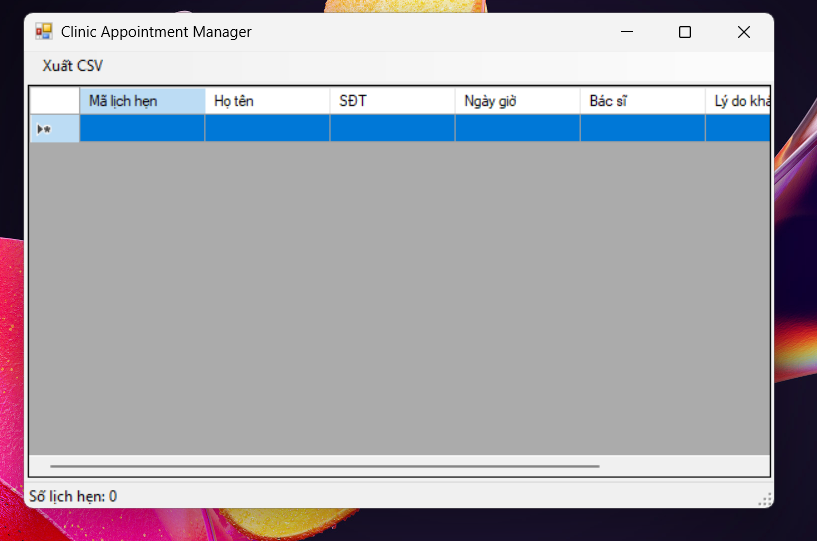
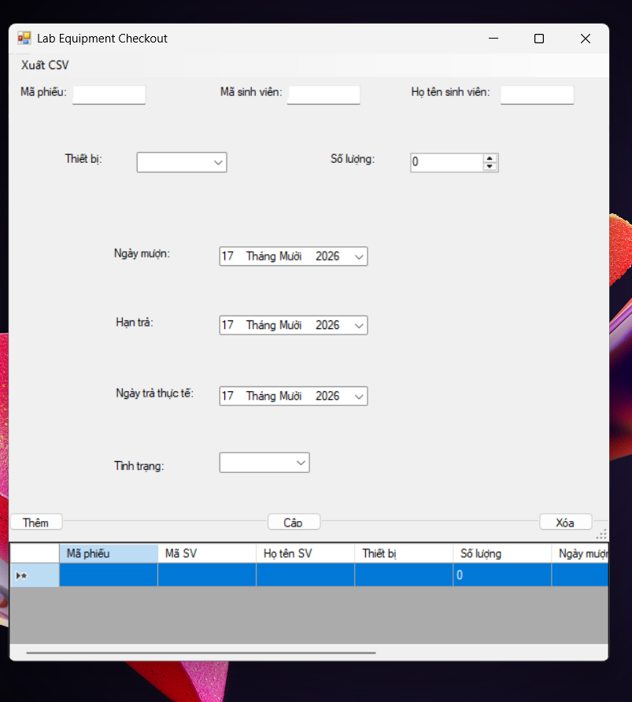
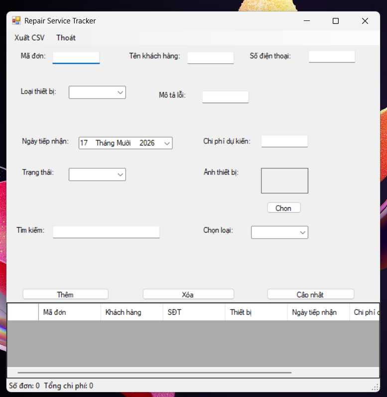

Markdown
# BÁO CÁO BÀI TẬP / ĐỒ ÁN

## THÔNG TIN SINH VIÊN
- Họ và tên: Nguyễn Trung Hiếu
- Mã số sinh viên: 24810320222
- Lớp: D19QTANM1
- Tên môn học: Lập trình C# / Windows Forms
- Tên bài tập: Ôn tập Window Form - 17/10/2026

---

## KẾT QUẢ THỰC HÀNH

### Bài 1: Quản lý lịch hẹn phòng khám

### Bài 2: Quản lý mượn trả tại phòng thực hành

### Bài 3: Quản lý đơn đăng ký dịch vụ sửa chữa

