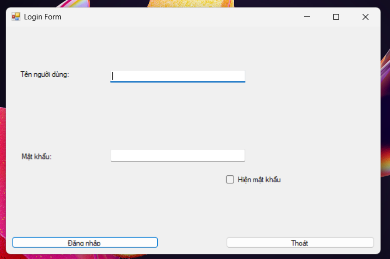
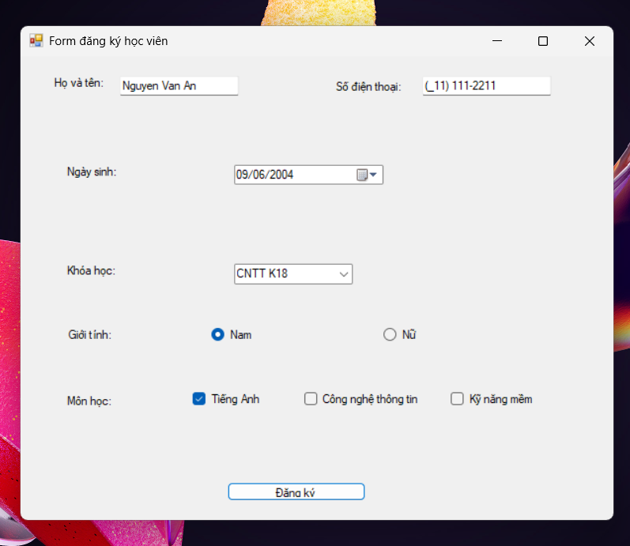
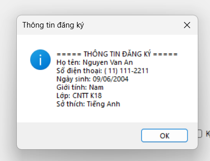

Markdown
# BÁO CÁO BÀI TẬP / ĐỒ ÁN

## THÔNG TIN SINH VIÊN
- **Họ và tên:** Nguyễn Trung Hiếu
- **Mã số sinh viên:** 24810320222
- **Lớp:** D19QTANM1
- **Tên môn học:** Lập trình C# / Windows Forms
- **Tên bài tập:** Ôn tập Windows Form - 28/10/2026

---

## KẾT QUẢ THỰC HÀNH

### Ảnh chụp bài 5.1: 

### Ảnh chụp bài 5.2: 

